<div align="center">

# MusicMind AI

### Deep Learning-Based Music Genre Classification

*Upload a track. Get its genre, with the evidence behind the prediction.*

[**Live Demo**](https://musicmind-ai.streamlit.app/) · [**Notebook**](notebooks/music_genre_classification.ipynb) · [**Results**](#results) · [**Quick Start**](#quick-start)

Python 3.11 · TensorFlow 2.21 · Streamlit · MIT License

</div>

---

## Overview

**MusicMind AI** is an end-to-end deep learning application that classifies music into **10 genres** using a custom **Convolutional Neural Network (CNN)** trained on **Mel Spectrograms**. It covers the full ML lifecycle: data cleaning, leakage-free splitting, feature extraction, model training, held-out evaluation, and deployment as an interactive **Streamlit** web app.

Instead of judging a whole track from a single prediction, the system splits each recording into ten 3-second segments, classifies every segment independently, and combines the results through **majority voting** for a more robust track-level decision.

### Highlights

| | |
|---|---|
| **82.43%** test accuracy | on an untouched held-out set of 148 tracks |
| **Leakage-aware** evaluation | track-level stratified split *before* segmentation |
| **Custom CNN** | 3 conv blocks, Global Average Pooling, saved as a Keras `.keras` artifact |
| **Segment-level voting** | 10 predictions per track, aggregated into one |
| **Deployed** | interactive Streamlit dashboard with rich visualizations |

---

## Table of Contents

- [Key Features](#key-features)
- [How It Works](#how-it-works)
- [Dataset](#dataset)
- [Methodology](#methodology)
- [Model Architecture](#model-architecture)
- [Results](#results)
- [Project Structure](#project-structure)
- [Quick Start](#quick-start)
- [Limitations](#limitations)
- [Tech Stack](#tech-stack)
- [Author](#author)

---

## Key Features

- **10-genre classification:** Blues, Classical, Country, Disco, Hip-Hop, Jazz, Metal, Pop, Reggae, Rock.
- **Segment-level inference + majority voting:** 10 independent predictions per track.
- **Rich prediction dashboard:** predicted genre, segment agreement, average softmax probability per genre, per-segment probability timeline, and ranked genres.
- **Multiple audio formats:** WAV, MP3, OGG, FLAC, and M4A (subject to decoder availability).
- **Product-style UI:** dark violet theme, upload validation, audio playback, plus sections for how it works, supported genres, held-out test metrics, model details, and limitations.
- **Reproducible artifacts:** model, config, split manifest, predictions, and evaluation reports are all versioned in the repo.

---

## How It Works

```mermaid
flowchart LR
    A[Audio Upload] --> B[Load and Validate]
    B --> C[Mono + Resample<br/>22,050 Hz]
    C --> D[Standardize to 30 s]
    D --> E[Split into 10 x 3 s segments]
    E --> F[Mel Spectrograms<br/>128 x 130]
    F --> G[CNN]
    G --> H[Per-segment predictions]
    H --> I[Majority Vote]
    I --> J[Predicted Genre]
    J --> K[Streamlit Dashboard]
```



---

## Dataset

The project uses the [**GTZAN Music Genre Dataset**](https://www.kaggle.com/datasets/andradaolteanu/gtzan-dataset-music-genre-classification), a widely used benchmark for music genre classification.

| Property | Value |
|---|---:|
| Original audio tracks | 1,000 |
| Genres | 10 |
| Cleaned audio tracks | 984 |
| Sample rate | 22,050 Hz |
| Track duration | 30 s |
| Training / Validation / Test | 688 / 148 / 148 |

### Data cleaning and splitting

- Corrupted audio files were excluded.
- Identified duplicate tracks were removed.
- Recordings were standardized to a consistent format.
- Splits were made at the **original track level** with **stratified sampling**.

> [!IMPORTANT]
> **Splitting happens *before* segment generation.** This guarantees that segments from the same track never appear in different splits, which prevents data leakage and keeps the reported test score honest. This is a common pitfall in segment-based audio classification.

---

## Methodology

<details open>
<summary><b>1. Audio preprocessing</b></summary>

<br>

- Load and decode audio
- Convert to mono
- Resample to 22,050 Hz
- Standardize to 30 seconds
- Divide into 10 non-overlapping 3-second segments

</details>

<details open>
<summary><b>2. Mel Spectrogram extraction</b></summary>

<br>

| Parameter | Value |
|---|---:|
| Sample rate | 22,050 Hz |
| FFT size | 2,048 |
| Hop length | 512 |
| Mel bins | 128 |
| Segment duration | 3 s |
| Spectrogram shape | 128 × 130 |

Spectrograms are converted to decibels, clipped to a fixed range, and normalized before entering the CNN.

</details>

<details open>
<summary><b>3. Model training</b></summary>

<br>

- Data augmentation to improve generalization
- Batch normalization for stable training
- Dropout for regularization
- Validation-based model selection (best checkpoint kept)

</details>

<details open>
<summary><b>4. Track-level prediction</b></summary>

<br>

1. Preprocess the uploaded recording
2. Extract 10 segments and compute a Mel Spectrogram for each
3. Run every spectrogram through the CNN
4. Collect the predicted genre per segment
5. Apply **majority voting**: the genre with the most segment votes wins

</details>

---

## Model Architecture

| Layer | Configuration |
|---|---|
| Input | `128 × 130 × 1` |
| Convolutional Block 1 | 32 filters |
| Convolutional Block 2 | 64 filters |
| Convolutional Block 3 | 128 filters |
| Per-block components | Batch Normalization → ReLU → Max Pooling |
| Feature aggregation | Global Average Pooling |
| Dense | 128 units |
| Regularization | Dropout (0.5) |
| Output | 10 classes, Softmax |

**Input:** `(128, 130, 1)`  **Output:** `(10,)`

The selected model is stored at `artifacts/models/musicmind_cnn_augmented_best.keras`.

---

## Results

Evaluated on an **untouched held-out test set of 148 tracks**.

### Overall performance

| Metric | Score |
|---|---:|
| **Test Accuracy** | **82.43%** |
| Balanced Accuracy | 82.43% |
| Macro F1-Score | 81.49% |
| Weighted F1-Score | 81.48% |

### Per-class performance

| Genre | Precision | Recall | F1-Score |
|---|---:|---:|---:|
| Blues | 0.94 | 1.00 | **0.97** |
| Classical | 0.88 | 1.00 | **0.94** |
| Jazz | 0.87 | 0.87 | 0.87 |
| Hip-Hop | 0.78 | 0.93 | 0.85 |
| Metal | 0.92 | 0.79 | 0.85 |
| Reggae | 1.00 | 0.73 | 0.85 |
| Country | 0.81 | 0.87 | 0.84 |
| Pop | 0.75 | 0.86 | 0.80 |
| Disco | 0.65 | 0.87 | 0.74 |
| Rock | 0.71 | 0.33 | 0.45 |

### Takeaways

- **Strongest:** Blues and Classical, with perfect recall, which reflects their distinctive timbral and harmonic character.
- **Weakest:** Rock (recall 0.33), the clear outlier. Rock overlaps acoustically with several neighboring genres.
- Full artifacts for deeper error analysis are in [`artifacts/reports/`](artifacts/reports), including the confusion matrix and per-track predictions.

> *Metrics are computed on GTZAN's held-out test split. Results may differ on other datasets or real-world recordings.*

---

## Project Structure

```text
MusicMind-AI/
├── app.py                          # Streamlit entry point
├── requirements.txt
├── .streamlit/config.toml          # Theme & server config
├── tests/test_pipeline.py          # Pipeline tests
│
├── artifacts/
│   ├── metadata/model_config.json
│   ├── models/musicmind_cnn_augmented_best.keras
│   └── reports/                    # Split manifest, predictions, confusion matrix, eval JSON
│
├── notebooks/
│   └── music_genre_classification.ipynb   # EDA, training & evaluation
│
└── src/musicmind/
    ├── audio/                      # loader · preprocessing · validation
    ├── models/inference.py         # Segment inference + majority voting
    ├── reports.py
    └── ui/                         # charts · components · constants · sections · theme
```

---

## Quick Start

**Prerequisites:** Python 3.11 and Git.

```bash
# 1. Clone
git clone https://github.com/AbdelrhmanAkl/MusicMind-AI.git
cd MusicMind-AI

# 2. Create a virtual environment
python -m venv .venv

# 3. Activate it
# Windows (PowerShell):
.venv\Scripts\Activate.ps1
# macOS / Linux:
source .venv/bin/activate

# 4. Install dependencies
python -m pip install --upgrade pip
pip install -r requirements.txt

# 5. Run the app
python -m streamlit run app.py
```

Then open **http://localhost:8501**, upload an audio file, and explore the prediction.

---

## Limitations

- Trained and evaluated on **GTZAN only**; generalization to other music sources is not guaranteed.
- Genres overlap acoustically, so some confusion is expected.
- **Rock** has the lowest recall (0.33) on the held-out test set.
- Audio quality, recording conditions, and blended genres can affect predictions.
- Majority voting yields a track-level answer but does not mean every segment belongs to that genre. Use the segment timeline to see the disagreement.

---

## Tech Stack

| Category | Tools |
|---|---|
| Language | Python |
| Deep Learning | TensorFlow, Keras |
| Audio Processing | Librosa, SoundFile |
| Data & ML | NumPy, Pandas, Scikit-learn |
| Visualization | Plotly |
| Web App | Streamlit |
| Workflow | Jupyter Notebook, Git, GitHub |

---

## Author

**Abdelrahman Akl** — AI & Machine Learning Engineer

[GitHub](https://github.com/AbdelrhmanAkl) · [LinkedIn](https://www.linkedin.com/in/abdelrahmanakl/)

<div align="center">

*If you found this project useful, consider giving it a star.*

</div>
