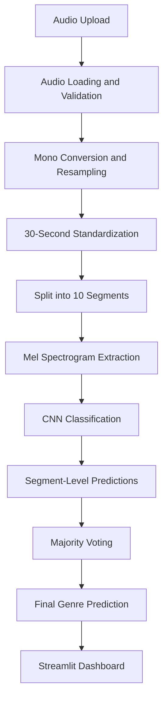

# MusicMind AI
### Deep Learning-Based Music Genre Classification

An end-to-end deep learning application that classifies music into 10 genres using a custom Convolutional Neural Network (CNN) trained on Mel Spectrograms.

Upload an audio track, explore its predicted genre, and inspect the segment-level predictions behind the final result.

**[Live Demo](https://musicmind-ai.streamlit.app/)** · **[Jupyter Notebook](notebooks/music_genre_classification.ipynb)** · **[Model Evaluation](#model-performance)**

`Python 3.11` `TensorFlow 2.21` `Keras` `Librosa` `Streamlit` `MIT License`

---

## Overview

MusicMind AI is an end-to-end music genre classification system built using deep learning and audio signal processing.

The project uses a custom Convolutional Neural Network (CNN) to classify audio recordings into 10 music genres based on their Mel Spectrogram representations.

Rather than relying on a single prediction for an entire recording, MusicMind processes each track as 10 independent 3-second segments. The individual predictions are then aggregated using majority voting to produce a track-level classification.

The project covers the complete machine learning workflow, including:

- Audio data cleaning and preprocessing.
- Leakage-aware dataset splitting.
- Mel Spectrogram feature extraction.
- CNN model development and training.
- Held-out test evaluation and error analysis.
- Model serialization and deployment.
- Interactive prediction dashboard development.

## Key Highlights

| Component | Description |
|---|---|
| Test Accuracy | 82.43% on 148 unseen tracks |
| Classification | 10 music genres |
| Architecture | Custom 3-block CNN |
| Audio Representation | 128-bin Mel Spectrograms |
| Inference Strategy | 10 segments per track with majority voting |
| Data Leakage Prevention | Track-level stratified splitting before segmentation |
| Deployment | Interactive Streamlit application |

---

## Supported Music Genres

The model recognizes the following 10 genres:

1. Blues
2. Classical
3. Country
4. Disco
5. Hip-Hop
6. Jazz
7. Metal
8. Pop
9. Reggae
10. Rock

## System Architecture

The inference pipeline transforms an uploaded audio recording into a final genre prediction through the following stages:



## Dataset

MusicMind AI uses the [GTZAN Music Genre Dataset](https://www.kaggle.com/datasets/andradaolteanu/gtzan-dataset-music-genre-classification), a widely used benchmark for music genre classification research.

### Dataset Summary

| Property | Value |
|---|---:|
| Original Audio Tracks | 1,000 |
| Number of Genres | 10 |
| Cleaned Audio Tracks | 984 |
| Sample Rate | 22,050 Hz |
| Standard Track Duration | 30 seconds |
| Training Tracks | 688 |
| Validation Tracks | 148 |
| Test Tracks | 148 |

### Data Cleaning and Preparation

The original dataset underwent a preprocessing and quality-control stage:

- Excluded corrupted audio recordings.
- Identified and removed duplicate tracks.
- Standardized audio recordings to a consistent format.
- Converted recordings to mono.
- Resampled audio to 22,050 Hz.

### Data Leakage Prevention

An important design decision was splitting the dataset at the original track level before generating audio segments.

This ensures that segments originating from the same recording cannot appear across different dataset splits.

As a result, the model is evaluated on previously unseen recordings rather than segments from tracks it may have encountered during training.

The dataset was divided using stratified sampling:

- Training: 688 tracks
- Validation: 148 tracks
- Testing: 148 tracks

---

## Methodology

### 1. Audio Preprocessing

Each recording passes through a standardized preprocessing pipeline:

- Audio loading and decoding.
- Stereo-to-mono conversion.
- Resampling to 22,050 Hz.
- Duration standardization to 30 seconds.
- Division into 10 non-overlapping segments of 3 seconds each.

### 2. Mel Spectrogram Feature Extraction

Each audio segment is transformed into a Mel Spectrogram, allowing the CNN to learn relevant time-frequency patterns.

| Parameter | Configuration |
|---|---:|
| Sample Rate | 22,050 Hz |
| FFT Size | 2,048 |
| Hop Length | 512 |
| Mel Bins | 128 |
| Segment Duration | 3 seconds |
| Spectrogram Dimensions | 128 × 130 |

The extracted spectrograms are converted to decibel representations, clipped to a fixed range, and normalized before being passed to the neural network.

### 3. CNN Model Training

A custom CNN architecture was developed to learn discriminative audio patterns.

The training pipeline incorporates:

- Data augmentation to improve generalization.
- Batch Normalization for more stable training.
- Dropout for regularization.
- Validation-based checkpoint selection.

### 4. Track-Level Inference

For each uploaded recording:

1. The audio is validated and preprocessed.
2. The recording is divided into 10 segments.
3. A Mel Spectrogram is extracted for each segment.
4. The CNN independently predicts the genre probabilities.
5. Majority voting aggregates the segment-level predictions.
6. The most frequently predicted genre becomes the final track-level classification.

---

## Model Architecture

MusicMind uses a custom Convolutional Neural Network consisting of three convolutional blocks followed by feature aggregation and classification layers.

| Layer | Configuration |
|---|---|
| Input | 128 × 130 × 1 |
| Convolutional Block 1 | 32 Filters |
| Convolutional Block 2 | 64 Filters |
| Convolutional Block 3 | 128 Filters |
| Block Components | Batch Normalization, ReLU, Max Pooling |
| Feature Aggregation | Global Average Pooling |
| Dense Layer | 128 Units |
| Regularization | Dropout (0.5) |
| Output Layer | 10 Classes, Softmax |

**Input Shape:** `(128, 130, 1)`

**Output Shape:** `(10,)`

The trained model is saved in Keras format:

`artifacts/models/musicmind_cnn_augmented_best.keras`

---

## Model Performance

The model was evaluated on an untouched held-out test set containing 148 original audio tracks.

### Overall Evaluation Metrics

| Metric | Score |
|---|---:|
| Test Accuracy | **82.43%** |
| Balanced Accuracy | 82.43% |
| Macro F1-Score | 81.49% |
| Weighted F1-Score | 81.48% |

### Per-Class Classification Performance

| Genre | Precision | Recall | F1-Score |
|---|---:|---:|---:|
| Blues | 0.94 | 1.00 | **0.97** |
| Classical | 0.88 | 1.00 | **0.94** |
| Jazz | 0.87 | 0.87 | 0.87 |
| Hip-Hop | 0.78 | 0.93 | 0.85 |
| Metal | 0.92 | 0.79 | 0.85 |
| Reggae | 1.00 | 0.73 | 0.85 |
| Country | 0.81 | 0.87 | 0.84 |
| Pop | 0.75 | 0.86 | 0.80 |
| Disco | 0.65 | 0.87 | 0.74 |
| Rock | 0.71 | 0.33 | 0.45 |

### Performance Analysis

**Best Performing Classes**

- Blues achieved an F1-score of 0.97.
- Classical achieved an F1-score of 0.94.
- Both classes achieved 1.00 recall on the held-out test set.

**Main Area for Improvement**

Rock achieved the lowest recall at 0.33, indicating difficulty distinguishing it from acoustically similar genres.

This highlights the challenges of music genre classification, particularly when different genres share similar instrumentation, rhythm, and spectral characteristics.

Detailed evaluation artifacts, including confusion matrices and track-level predictions, are available in `artifacts/reports/`.

*All reported metrics are based on the GTZAN held-out test split. Performance on other datasets and real-world recordings may vary.*

---

## Interactive Web Application

MusicMind AI is deployed as an interactive Streamlit application.

### Application Features

- Audio file upload and validation.
- Support for WAV, MP3, OGG, FLAC, and M4A formats, subject to decoder availability.
- Audio playback.
- Final track-level genre prediction.
- Segment-level prediction analysis.
- Segment agreement visualization.
- Average genre probability distribution.
- Per-segment probability timeline.
- Ranked genre predictions.
- Model information and evaluation metrics.

**Live Application:** https://musicmind-ai.streamlit.app/

---

## Project Structure

```text
MusicMind-AI/
│
├── app.py
├── requirements.txt
├── .streamlit/
│   └── config.toml
│
├── artifacts/
│   ├── metadata/
│   │   └── model_config.json
│   ├── models/
│   │   └── musicmind_cnn_augmented_best.keras
│   └── reports/
│       ├── split manifests
│       ├── predictions
│       ├── confusion matrix
│       └── evaluation reports
│
├── notebooks/
│   └── music_genre_classification.ipynb
│
├── src/
│   └── musicmind/
│       ├── audio/
│       ├── models/
│       │   └── inference.py
│       ├── reports.py
│       └── ui/
│
├── tests/
│   └── test_pipeline.py
│
└── README.md
```

---

## Quick Start

### Prerequisites

- Python 3.11
- Git

### Installation

**1. Clone the repository**

```bash
git clone https://github.com/AbdelrhmanAkl/MusicMind-AI.git
cd MusicMind-AI
```

**2. Create a virtual environment**

```bash
python -m venv .venv
```

**3. Activate the environment**

Windows PowerShell:

```powershell
.venv\Scripts\Activate.ps1
```

macOS / Linux:

```bash
source .venv/bin/activate
```

**4. Install dependencies**

```bash
python -m pip install --upgrade pip
pip install -r requirements.txt
```

**5. Launch the application**

```bash
python -m streamlit run app.py
```

Open the following address in your browser:

`http://localhost:8501`

Upload an audio recording to start exploring the model's predictions.

---

## Limitations and Future Improvements

### Current Limitations

- Training and evaluation are based exclusively on the GTZAN dataset.
- Generalization to different music datasets and recording environments is not guaranteed.
- Genre overlap can lead to classification errors.
- Rock has relatively low recall on the current test split.
- Audio quality, recording conditions, and blended genres can affect predictions.
- Majority voting produces one track-level result but does not imply that every segment belongs to the predicted genre.

### Potential Improvements

- Evaluate the model on additional music genre datasets.
- Experiment with alternative CNN architectures and transfer learning.
- Explore attention-based audio classification models.
- Improve performance on acoustically overlapping genres.
- Investigate more advanced segment aggregation strategies.

---

## Technology Stack

| Category | Technologies |
|---|---|
| Programming Language | Python 3.11 |
| Deep Learning | TensorFlow, Keras |
| Audio Processing | Librosa, SoundFile |
| Data Processing | NumPy, Pandas |
| Machine Learning | Scikit-learn |
| Visualization | Plotly |
| Web Application | Streamlit |
| Development | Jupyter Notebook, Git, GitHub |

---

## Author

**Abdelrahman Akl**  
AI & Machine Learning Engineer

- **GitHub:** [AbdelrahmanAkl](https://github.com/AbdelrhmanAkl)
- **LinkedIn:** [Abdelrahman Akl](https://www.linkedin.com/in/abdelrahmanakl/)

---

## License

This project is licensed under the MIT License. See the [LICENSE](LICENSE) file for details.

---

*MusicMind AI — From audio signals to intelligent music classification.*
